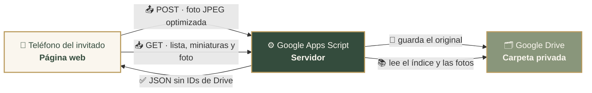

<div align="center">


# 📸 Fotos para bodas

### *Cada fotografía guarda un recuerdo.*

**Una aplicación web para que los invitados tomen, compartan y guarden las fotos de la boda… con solo escanear un código QR.**

<br>


<br>

[✨ Funcionalidades](#funcionalidades) ·
[🧭 Cómo funciona](#como-funciona) ·
[🏛️ Arquitectura](#arquitectura) ·
[🗂️ Estructura](#estructura) ·
[🚀 Ejecución local](#ejecucion-local) ·
[⚙️ Configuración](#configuracion) ·
[🗺️ Estado](#estado)

</div>

---

## 💐 ¿Qué es?

**Fotos para bodas** convierte a cada invitado en fotógrafo de la boda.

Sin descargar aplicaciones, sin crear cuentas y sin contraseñas: el invitado **escanea el QR**, toma o elige una foto, confirma que quiere compartirla y en segundos aparece en la **galería compartida**, donde todos pueden verla, ampliarla y guardarla en su teléfono.

Las fotografías se guardan en una carpeta **privada de Google Drive** del organizador, a través de **Google Apps Script**.

> [!NOTE]
> El proyecto está **en desarrollo y pruebas**. Todavía no tiene versión oficial publicada ni código QR definitivo.

---

<a id="funcionalidades"></a>

## ✨ Funcionalidades

<table>
<tr>
<td width="50%" valign="top">

### 📷 Para tomar y compartir
- **Cámara integrada** con cambio entre cámara frontal y trasera, y la cámara nativa como respaldo.
- **Selección de fotos** desde la galería del teléfono o la computadora.
- **Vista previa y confirmación** antes de compartir: «Sí, compartir fotografía».
- **Optimización automática**: JPEG de hasta 2560 px, sin deformar y **sin ubicación GPS**.
- **Subida segura** con confirmación real del guardado, reintentos y **sin duplicados** por reintentos.

</td>
<td width="50%" valign="top">

### 🖼️ Para ver y guardar
- **Galería compartida** con las fotos de todos, miniaturas optimizadas y «Cargar más».
- **Actualización automática** cada 30 s, sin repetir fotos ni interrumpir a quien está mirando.
- **Visor** a pantalla completa con «Anterior / Siguiente».
- **Guardar fotografía**: en iPhone abre el menú compartir y en Android y computadora descarga el JPEG completo.
- **Mi galería**: las fotos de cada invitado, con su estado, **guardadas en su teléfono** aunque cierre la página.

</td>
</tr>
</table>

### ✅ Estado de cada funcionalidad

| | Funcionalidad | Estado |
|:-:|---|---|
| 🔳 | Acceso mediante código QR | 🔜 Se generará con la versión oficial |
| 📷 | Cámara del dispositivo (frontal y trasera) | ✅ Implementada y probada |
| 🖼️ | Selección de imágenes | ✅ Implementada y probada |
| 👀 | Vista previa y confirmación | ✅ Implementada y probada |
| ☁️ | Subida a Google Drive mediante Google Apps Script | ✅ Implementada y probada |
| 🌸 | Galería compartida | ✅ Implementada y probada |
| 🔄 | Actualización automática | ✅ Implementada y probada |
| 🔍 | Visor de fotografías | ✅ Implementado y probado |
| 💾 | Descarga de fotografías | ✅ Probada en iPhone y computadora · 🔜 falta verificar en Android |
| 💚 | «Mi galería» persistente (IndexedDB) | ✅ Implementada y probada en iPhone · solo en el dispositivo de cada invitado |
| 📱 | Diseño adaptable a teléfonos y computadoras | ✅ Implementado |

> [!TIP]
> **Sencilla a propósito:** sin cuentas para los invitados, sin moderación ni aprobaciones, y sin límite de fotos por persona. Solo hay protecciones técnicas: formato, tamaño por archivo, ritmo de subidas y concurrencia.

---

<a id="como-funciona"></a>

## 🧭 Cómo funciona

| 1️⃣ Escanea | 2️⃣ Captura | 3️⃣ Comparte | 4️⃣ Disfruta |
|:-:|:-:|:-:|:-:|
| El invitado escanea el **código QR** y se abre la página de la boda. | Toma una foto con la cámara o la **elige de su galería**. | Revisa la vista previa y pulsa **«Sí, compartir fotografía»**. | La foto aparece en la **galería de todos**, lista para verla y guardarla. |

---

<a id="arquitectura"></a>

## 🏛️ Arquitectura



- **🌐 La página web** (HTML, CSS y JavaScript estáticos) optimiza la foto en el propio teléfono y la envía con `fetch` como una petición simple (`text/plain`, sin cookies), compatible con Safari en iPhone.
- **⚙️ Google Apps Script** actúa como servidor con la cuenta del organizador. Valida cada foto (formato, tamaño y contenido JPEG real), la guarda en Drive y confirma el guardado con un JSON.
- **🗂️ Google Drive** guarda los originales en una carpeta **privada**. Un índice interno permite listar la galería sin recorrer toda la carpeta en cada consulta.
- **🌸 La galería compartida** pide la lista de fotos, las miniaturas (en lotes y con caché) y la foto completa solo cuando alguien la abre. Las imágenes viajan dentro del JSON: **la carpeta nunca se hace pública**.

<details>
<summary><b>📡 Ver los servicios del servidor</b></summary>

<br>

| Petición | Para qué sirve |
|---|---|
| `GET  /exec` | Comprobar que el servidor funciona. |
| `GET  /exec?accion=lista` | Lista paginada de fotos (códigos públicos y fechas). |
| `GET  /exec?accion=miniaturas&refs=…` | Miniaturas optimizadas (~480 px), hasta 12 por petición. |
| `GET  /exec?accion=foto&ref=…` | Foto completa, sin metadatos EXIF ni GPS. |
| `POST /exec` | Subir una fotografía. |

> El código del servidor (`Código.gs`) vive en el proyecto de Google Apps Script y en una copia privada. **No forma parte de este repositorio.**

</details>

---

<a id="estructura"></a>

## 🗂️ Estructura del proyecto

```text
📁 fotos-para-bodas
├── 📄 index.html            Página: portada, captura, vista previa, confirmación, galerías y visor
├── 🎨 style.css             Estilos e identidad visual
├── ⚙️ script.js             Lógica: cámara, subida, galerías, visor y «Mi galería»
├── 🔧 config.js             Configuración pública (URL del servidor y clave pública del evento)
└── 📁 assets
    ├── 🖼️ pareja-600.jpg · pareja-900.jpg · pareja-original.jpg   Fotografía principal
    ├── 🌿 flores-esquina.svg                                       Adorno floral
    ├── ✦ divisor.svg                                               Separador decorativo
    └── 📁 iconos                                                   14 íconos SVG de la interfaz
```

<details>
<summary><b>🛠️ Archivos solo para desarrollo local (no se publican)</b></summary>

<br>

| Archivo | Uso |
|---|---|
| `prueba-subida.html` · `prueba-subida.js` | Página interna para diagnosticar la conexión con Apps Script. |
| `servidor-https.py` | Servidor HTTPS local para probar desde teléfonos en la misma red Wi-Fi. |
| `certs/` | Certificado local de desarrollo. ⚠️ **Contiene una clave privada: nunca debe subirse.** |
| `.claude/launch.json` | Configuración del entorno de desarrollo. |

</details>

> [!IMPORTANT]
> Solo `index.html`, `style.css`, `script.js`, `config.js` y `assets/` forman el sitio público. Antes de subir el proyecto a GitHub, excluye `certs/`, los archivos de prueba y las herramientas locales (por ejemplo, con un `.gitignore`).

---

<a id="ejecucion-local"></a>

## 🚀 Ejecución local

**Requisitos:** un navegador moderno y **Python 3** (incluido en macOS). Para probar desde teléfonos, también [mkcert](https://github.com/FiloSottile/mkcert).

### 💻 En la computadora

La cámara del navegador solo funciona en conexiones seguras, y `localhost` cuenta como segura.

```bash
python3 -m http.server 8080 --bind 127.0.0.1
```

Abre 👉 `http://localhost:8080`

<details>
<summary><b>📱 Desde teléfonos en la misma red Wi-Fi (HTTPS)</b></summary>

<br>

**1.** Crea una autoridad local y el certificado de tu computadora:

```bash
mkcert -install
mkcert -cert-file certs/boda-local.pem -key-file certs/boda-local-key.pem \
       localhost nombre-de-tu-mac.local 192.168.X.X
```

**2.** Instala y activa en el teléfono el certificado raíz de mkcert. En iPhone: *Ajustes → General → Información → Ajustes de confianza de certificados*.

**3.** Inicia el servidor HTTPS local:

```bash
python3 servidor-https.py
```

**4.** Abre en el teléfono 👉 `https://192.168.X.X:8443`, con la IP de tu computadora.

> El servidor local solo entrega archivos: no recibe ni guarda fotografías, y bloquea `certs/` y los archivos ocultos.

</details>

---

<a id="configuracion"></a>

## ⚙️ Configuración

### 🌐 Página web · `config.js`

> [!WARNING]
> Todo lo que hay en `config.js` es **público**: cualquiera puede verlo en el navegador. Nunca incluyas contraseñas, tokens ni credenciales.

```js
window.BODA_CONFIG = Object.freeze({
  urlServidor: 'https://script.google.com/macros/s/TU_ID_DE_IMPLEMENTACION/exec',
  claveEvento: 'hm-xxxxxxxxxxxxxxxx', // identificador público del evento (no es una contraseña)
  servicio: 'nombre-del-servicio'     // debe coincidir con el nombre configurado en Apps Script
});
```

| Variable | Descripción |
|---|---|
| `urlServidor` | URL de la aplicación web de Apps Script (termina en `/exec`). |
| `claveEvento` | Identificador público que filtra peticiones al azar. **No es una medida de seguridad.** |
| `servicio` | Nombre que el servidor incluye en cada respuesta, para comprobar que proviene del servidor correcto. |

<details>
<summary><b>⚙️ Servidor · Google Apps Script</b></summary>

<br>

**Servicio avanzado:** agregar **Drive API** (identificador `Drive`) para las miniaturas optimizadas.

**Propiedades del script** (*Configuración del proyecto → Propiedades del script*), con valores de ejemplo:

| Propiedad | Ejemplo | Descripción |
|---|---|---|
| `SUBIDAS_ACTIVAS` | `false` | Interruptor general. Se activa durante el evento o en pruebas controladas. |
| `CARPETA_SUBIDAS` | `ID_DE_TU_CARPETA` | Carpeta privada de Google Drive donde se guardan las fotos. |
| `CLAVE_EVENTO` | `hm-xxxxxxxxxxxxxxxx` | Debe coincidir con `claveEvento` de `config.js`. |
| `LIMITE_POR_MINUTO` | `60` | Protección frente a envíos automatizados excesivos (valor en revisión). |
| `LIMITE_POR_DIA` | `2000` | Freno técnico de seguridad (valor en revisión; no se usará como límite para los invitados). |

**Implementación como aplicación web:**

- *Ejecutar como:* **Yo** (la cuenta dueña de la carpeta).
- *Quién tiene acceso:* **Cualquier usuario** (los invitados no inician sesión).
- Para actualizar el código sin cambiar la URL: *Gestionar implementaciones → Editar → Nueva versión*.

</details>

---

## 🔒 Seguridad y privacidad

| | |
|:-:|---|
| 🗂️ | La **carpeta de Google Drive es privada**: nunca se generan enlaces públicos. |
| 🙈 | Las respuestas públicas **no incluyen** IDs de Drive, correos, tokens ni enlaces internos, solo códigos públicos opacos. |
| 📍 | Las fotos se entregan **sin metadatos EXIF ni ubicación GPS**. |
| 🛡️ | El servidor valida el formato (JPEG real), el tamaño máximo (8 MB por archivo) y el ritmo de subidas, y usa bloqueos para las subidas simultáneas. |
| 🔑 | La clave del evento está en el código público y en el enlace del QR, por lo que **no hace privada la galería**: cualquier persona con el enlace puede ver las fotos compartidas. |

---

<a id="estado"></a>

## 🗺️ Estado del proyecto

🚧 **En desarrollo y pruebas** · pendiente de su publicación oficial.

**Completado**

- [x] Diseño, cámara, selección, vista previa y confirmación
- [x] Optimización de imágenes y subida a Google Drive con confirmación real
- [x] Galería compartida con miniaturas optimizadas, paginación y actualización automática
- [x] Visor con navegación y botón «Guardar fotografía»
- [x] «Mi galería» persistente con IndexedDB

**Próximos pasos**

- [ ] Ajuste de límites y mejoras de rendimiento para muchos invitados a la vez
- [ ] Aviso amable al intentar compartir de nuevo la misma fotografía
- [ ] Verificación de descargas en Android
- [ ] Pruebas integrales en iPhone, Android y computadora
- [ ] Versión oficial: cuenta, carpeta y Apps Script definitivos, publicación con HTTPS y código QR

---

<div align="center">


**Desarrollado por NeitorCompany** ⚡
<br>
Creado por Alan Leiva

<sub>© 2026 NeitorCompany. Todos los derechos reservados.</sub>

<sub>Este proyecto no se distribuye bajo una licencia de código abierto. No está permitido copiar, modificar ni redistribuir su código ni su diseño sin autorización expresa de NeitorCompany.</sub>

</div>
