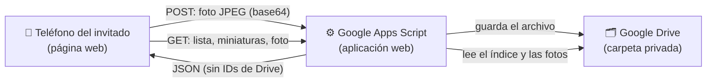

# Fotos para bodas | NeitorCompany

Aplicación web que permite a los invitados de una boda **tomar, compartir, visualizar y guardar fotografías** desde su propio teléfono, con solo escanear un código QR. Sin instalar aplicaciones, sin crear cuentas y sin iniciar sesión.

Las fotografías se guardan en una carpeta de **Google Drive** del organizador a través de **Google Apps Script**, y todos los invitados pueden verlas en una **galería compartida** que se actualiza sola.

> **Estado:** en desarrollo y pruebas. Todavía no está publicada oficialmente ni se ha generado el código QR definitivo.

---

## Tabla de contenido

- [Funcionalidades](#funcionalidades)
- [Tecnologías](#tecnologías)
- [Arquitectura general](#arquitectura-general)
- [Estructura de carpetas](#estructura-de-carpetas)
- [Instalación y ejecución local](#instalación-y-ejecución-local)
- [Configuración](#configuración)
- [Seguridad y privacidad](#seguridad-y-privacidad)
- [Estado del proyecto](#estado-del-proyecto)
- [Autoría](#autoría)

---

## Funcionalidades

| Funcionalidad | Descripción | Estado |
|---|---|---|
| Acceso mediante código QR | El QR abrirá directamente la página de la boda; no se necesitan cuentas ni contraseñas. | 🔜 El QR definitivo se generará al publicar la versión oficial |
| Cámara del dispositivo | Cámara integrada en la página, con cambio entre cámara frontal y trasera. Si el navegador no la permite, se usa la cámara nativa del teléfono. | ✅ Implementada y probada |
| Selección de imágenes | Elegir fotografías desde la galería del teléfono o la computadora. | ✅ Implementada y probada |
| Vista previa y confirmación | Antes de compartir, el invitado revisa la foto y confirma con «Sí, compartir fotografía». | ✅ Implementada y probada |
| Optimización de imágenes | Conversión a JPEG (máx. 2560 px), sin deformar la foto y **sin datos de ubicación (GPS)**. | ✅ Implementada y probada |
| Subida a Google Drive | Envío mediante Google Apps Script, con confirmación real del guardado, reintentos y prevención de duplicados por reintentos. | ✅ Implementada y probada |
| Galería compartida | Cuadrícula con las fotos de todos los invitados, miniaturas optimizadas y carga por páginas («Cargar más»). | ✅ Implementada y probada |
| Actualización automática | La galería consulta fotos nuevas cada 30 s mientras está visible, sin duplicarlas ni interrumpir el visor. Incluye botón «Actualizar galería». | ✅ Implementada y probada |
| Visor de fotografías | Foto en tamaño grande con navegación «Anterior / Siguiente» y botón atrás del teléfono. | ✅ Implementada y probada |
| Descarga de fotografías | Botón «Guardar fotografía»: menú compartir en iPhone (Guardar imagen) y descarga JPEG en Android y computadora. Siempre la foto completa. | ✅ Probada en iPhone y computadora · 🔜 Pendiente de verificar en Android |
| «Mi galería» | Las fotos que el invitado eligió en su teléfono, con su estado («Compartida», «Enviando…», «No enviada»), reintento manual y opción «Limpiar mi galería». **Se conserva al recargar o cerrar la página** (IndexedDB). Es local a cada navegador y dispositivo. | ✅ Implementada y probada en iPhone |
| Diseño adaptable | Pensado primero para teléfonos; también funciona en tabletas y computadoras. | ✅ Implementado |

### Decisiones de diseño

- **Sin cuentas ni contraseñas** para los invitados: basta con escanear el QR.
- **Sin moderación ni aprobación previa**: cuando una foto se comparte correctamente, aparece en la galería para todos.
- **Sin límite por invitado**: solo hay protecciones técnicas (formato, tamaño por archivo, ritmo de subidas y concurrencia).

---

## Tecnologías

| Tecnología | Uso |
|---|---|
| **HTML5** | Estructura de la página. |
| **CSS3** | Diseño adaptable, animaciones e íconos SVG mediante máscaras. |
| **JavaScript** (sin frameworks) | Cámara (`getUserMedia`), optimización con `canvas`, comunicación con el servidor (`fetch`), galería y visor. |
| **IndexedDB** | Persistencia de «Mi galería» en el navegador de cada dispositivo. |
| **Google Apps Script** | Servidor web: recibe las fotos, las valida y entrega la galería en modo de solo lectura. |
| **Google Drive** | Almacenamiento privado de las fotografías. |
| **Git y GitHub** | Control de versiones y publicación del sitio. |

No se usan librerías externas de JavaScript. Las tipografías se cargan desde Google Fonts.

---

## Arquitectura general



1. **La página web** (HTML, CSS y JavaScript estáticos) se ejecuta en el navegador del invitado. Optimiza la foto en el propio teléfono y la envía con `fetch` como una petición simple (`text/plain`, sin cookies), compatible con Safari en iPhone.
2. **Google Apps Script** actúa como servidor. Se ejecuta con la cuenta del organizador, valida cada foto (formato, tamaño y contenido JPEG real), la guarda en Drive y responde un JSON con la confirmación.
3. **Google Drive** guarda los originales en una carpeta **privada**. Un índice interno permite listar la galería sin recorrer toda la carpeta en cada consulta.
4. **La galería compartida** pide al servidor la lista de fotos, las miniaturas (en lotes y con caché) y la foto completa solo cuando el invitado la abre. Las imágenes viajan en base64 dentro del JSON: la carpeta nunca se hace pública.

### Servicios del servidor

| Petición | Uso |
|---|---|
| `GET /exec` | Comprobación de estado del servidor. |
| `GET /exec?accion=lista` | Lista paginada de fotos (códigos públicos y fechas). |
| `GET /exec?accion=miniaturas&refs=…` | Miniaturas optimizadas (~480 px), hasta 12 por petición. |
| `GET /exec?accion=foto&ref=…` | Foto completa, sin metadatos EXIF/GPS. |
| `POST /exec` | Subida de una fotografía. |

> El código de Google Apps Script (`Código.gs`) se mantiene en el proyecto de Apps Script y en una copia privada; **no forma parte de este repositorio**.

---

## Estructura de carpetas

```
.
├── index.html            # Página principal: portada, captura, vista previa, confirmación, galerías y visor
├── style.css             # Estilos e identidad visual
├── script.js             # Lógica de la aplicación (cámara, subida, galerías, visor, «Mi galería»)
├── config.js             # Configuración pública (URL del servidor y clave pública del evento)
├── assets/
│   ├── pareja-600.jpg        # Fotografía principal en varios tamaños
│   ├── pareja-900.jpg
│   ├── pareja-original.jpg
│   ├── flores-esquina.svg    # Adorno floral
│   ├── divisor.svg           # Separador decorativo
│   └── iconos/               # 14 íconos SVG de la interfaz: anterior, camara, cambiar,
│                             # cerrar, confirmado, corazon, galeria, guardar, imagen,
│                             # inicio, limpiar, rayo, repetir y siguiente
│
│   — Solo para desarrollo local (no forman parte del sitio publicado) —
├── prueba-subida.html    # Página interna de diagnóstico de la conexión con Apps Script
├── prueba-subida.js
├── servidor-https.py     # Servidor HTTPS local para probar desde teléfonos en la misma red Wi-Fi
├── certs/                # Certificado local de desarrollo (⚠️ contiene una clave privada: NUNCA subir)
└── .claude/launch.json   # Configuración del entorno de desarrollo
```

### Archivos que se publican

Solo estos forman el sitio público:

```
index.html · style.css · script.js · config.js · assets/
```

> ⚠️ Antes de subir el proyecto a GitHub, excluye `certs/`, los archivos de prueba y las herramientas locales (por ejemplo, con un archivo `.gitignore`).

---

## Instalación y ejecución local

### Requisitos

- Un navegador moderno (Safari, Chrome, Edge o Firefox).
- **Python 3** para el servidor local (incluido en macOS).
- Opcional, para probar desde teléfonos: [mkcert](https://github.com/FiloSottile/mkcert) para crear un certificado HTTPS local.

### Opción 1 — En la computadora

La cámara del navegador solo funciona en una conexión segura; `localhost` cuenta como segura.

```bash
cd fotos-para-bodas
python3 -m http.server 8080 --bind 127.0.0.1
```

Abre `http://localhost:8080` en el navegador.

### Opción 2 — Desde teléfonos en la misma red Wi-Fi (HTTPS)

1. Crea e instala una autoridad local y un certificado para tu computadora:

   ```bash
   mkcert -install
   mkcert -cert-file certs/boda-local.pem -key-file certs/boda-local-key.pem \
          localhost nombre-de-tu-mac.local 192.168.X.X
   ```

2. Instala y activa en el teléfono el certificado raíz de mkcert (en iPhone: *Ajustes → General → Información → Ajustes de confianza de certificados*).

3. Inicia el servidor HTTPS local:

   ```bash
   python3 servidor-https.py
   ```

4. Abre en el teléfono `https://192.168.X.X:8443` (la IP de tu computadora).

> El servidor local solo entrega archivos; no recibe ni guarda fotografías. Bloquea `certs/` y los archivos ocultos.

---

## Configuración

### 1. Página web — `config.js`

Toda la configuración de este archivo es **pública** (cualquiera puede verla en el navegador). Nunca incluyas contraseñas, tokens ni credenciales.

```js
window.BODA_CONFIG = Object.freeze({
  urlServidor: 'https://script.google.com/macros/s/TU_ID_DE_IMPLEMENTACION/exec',
  claveEvento: 'hm-xxxxxxxxxxxxxxxx', // identificador público del evento (no es una contraseña)
  servicio: 'nombre-del-servicio'     // debe coincidir con el nombre configurado en Apps Script
});
```

| Variable | Descripción |
|---|---|
| `urlServidor` | URL de la aplicación web de Apps Script (termina en `/exec`). |
| `claveEvento` | Identificador público que filtra peticiones al azar. **No es una medida de seguridad.** |
| `servicio` | Nombre que el servidor incluye en cada respuesta, para comprobar que proviene del servidor correcto. |

### 2. Servidor — Google Apps Script

**Servicio avanzado:** agregar **Drive API** (identificador `Drive`) para las miniaturas optimizadas.

**Propiedades del script** (*Configuración del proyecto → Propiedades del script*), con valores de ejemplo:

| Propiedad | Ejemplo | Descripción |
|---|---|---|
| `SUBIDAS_ACTIVAS` | `false` | Interruptor general. Las subidas solo se activan durante el evento o en pruebas controladas. |
| `CARPETA_SUBIDAS` | `ID_DE_TU_CARPETA` | Carpeta privada de Google Drive donde se guardan las fotos. |
| `CLAVE_EVENTO` | `hm-xxxxxxxxxxxxxxxx` | Debe coincidir con `claveEvento` de `config.js`. |
| `LIMITE_POR_MINUTO` | `60` | Protección frente a envíos automatizados excesivos (valor en revisión). |
| `LIMITE_POR_DIA` | `2000` | Freno técnico de seguridad (valor en revisión; no se usará como límite para los invitados). |

**Implementación (aplicación web):**

- *Ejecutar como:* **Yo** (la cuenta dueña de la carpeta).
- *Quién tiene acceso:* **Cualquier usuario** (los invitados no inician sesión).
- Para actualizar el código sin cambiar la URL: *Gestionar implementaciones → Editar → Nueva versión*.

---

## Seguridad y privacidad

- La **carpeta de Google Drive es privada**; nunca se generan enlaces públicos.
- Las respuestas públicas **no incluyen** IDs de Drive, correos, tokens ni enlaces internos: solo códigos públicos opacos.
- Las fotos se entregan **sin metadatos EXIF ni ubicación GPS**.
- El servidor valida el formato (JPEG real), el tamaño máximo por archivo (8 MB) y el ritmo de subidas, y usa bloqueos para las subidas simultáneas.
- **Importante:** la clave del evento está en el código público y en el enlace del QR, por lo que **no hace privada la galería**. Cualquier persona con el enlace puede ver las fotos compartidas.

---

## Estado del proyecto

🚧 **En desarrollo y pruebas**, pendiente de su publicación oficial.

**Completado**

- Diseño, cámara, selección, vista previa y confirmación.
- Optimización de imágenes y subida a Google Drive con confirmación real.
- Galería compartida con miniaturas optimizadas, paginación y actualización automática.
- Visor con navegación y botón «Guardar fotografía».
- «Mi galería» persistente con IndexedDB.

**Pendiente**

- Ajuste de límites y mejoras de rendimiento para muchos invitados a la vez.
- Aviso amable cuando se intenta compartir de nuevo la misma fotografía.
- Verificación de descargas en Android.
- Pruebas integrales en iPhone, Android y computadora.
- Versión oficial: cuenta, carpeta y Apps Script definitivos, publicación con HTTPS y generación del código QR.

---

## Autoría

**Desarrollado por NeitorCompany**
Creado por Alan Leiva

© 2026 NeitorCompany. Todos los derechos reservados.

Este proyecto **no** se distribuye bajo una licencia de código abierto. No está permitido copiar, modificar ni redistribuir su código o su diseño sin autorización expresa de NeitorCompany.
